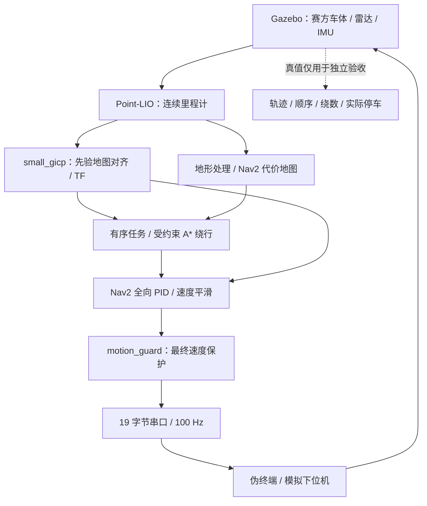

# SRM 校内赛自主导航

基于公开项目 [pb2025_sentry_nav](https://github.com/SMBU-PolarBear-Robotics-Team/pb2025_sentry_nav)，实现从停车位出发、逆时针绕下桩、顺时针绕上桩、沿原路回位的自主导航。支持障碍停车、移除恢复、持续障碍绕行、输入失效保护和比赛串口协议。

本机已完成仿真闭环及 31 包构建、77 项测试；NUC 已接通真实 MID-360、Point-LIO、地图配准和 Nav2 待机链。实车入口锁定任务启动与最终零速输出，比赛场地测绘、精度标定、固件协议和断链停机仍需现场验收。

## 项目架构



- **定位**：Point-LIO 接收点云和 IMU；small_gicp 将当前点云与先验对齐，组成 `map → odom → base_footprint`。传感器模式不使用 Gazebo 真值定位。
- **任务与避障**：自有任务层保存下瓣、上瓣、交叉点和返回段进度，通过 `FollowPath` 执行分段路径。持续阻挡 5 秒后尝试绕行，保持路线走廊、绕桩顺序和绕数；无路可走保持停车。
- **控制与通信**：`motion_guard` 是最终 `cmd_vel` 的唯一发布者，负责时效、限幅和危险区检查。串口模拟中，底盘只能通过 `serial_bridge → 伪终端 → sim_mcu` 接收速度。
- **场景**：使用 [赛方圆柱哨兵模型](simulation/models/sentry_robot_cylinder.xacro)和公开 MID-360 资源，导航包络半径 0.29 m。场地、平面动力学和解析先验仍是仿真假设。

| 目录 | 作用 |
|---|---|
| [intramural_mission](nav_ws/src/intramural_mission/) | 有序任务、绕行、仿真点云适配和速度保护 |
| [intramural_base](nav_ws/src/intramural_base/) | CRC、串口协议、底盘桥、模拟下位机和 ROS 清理 |
| [launch](launch/)、[config](config/) | 启动组合、场地参数、通信与车辆配置 |
| [scripts](scripts/README.md)、[tests](tests/) | 构建、运行、诊断和验收 |
| [docker](docker/)、[patches](patches/README.md) | Humble 环境、固定源码及公开修复 |
| [docs](docs/) | 技术细节、调试日志与精选结果 |

9 个顶层公开依赖以 Git 子模块登记，递归包含 pb2025 的 7 个子模块；small_gicp 和 Livox SDK 源码由准备脚本下载到 `cache/`。版本和 5 个修复补丁由 [sources.lock.json](docker/sources.lock.json) 固定。克隆后必须执行源码准备，GitHub 源码 ZIP 不含子模块内容。许可证与来源见 [THIRD_PARTY](THIRD_PARTY.md)。

## 开发机准备

开发环境为 Ubuntu 22.04 / ROS 2 Humble / Ignition Fortress。WSL2 使用 Docker、WSLg 和 GPU 渲染；需要 Docker 可用及桌面显示接口。环境和渲染细节见[环境说明](docs/deployment/environment.md)与 [GPU 配置](docs/deployment/gpu.md)。

```bash
git clone --recurse-submodules git@github.com:Alkapuce/srm-intramural-navigation.git
cd srm-intramural-navigation
python3 scripts/prepare-sources.py
python3 scripts/sources.py status
scripts/build-image.sh
scripts/build-workspace.sh
scripts/check-environment.sh
```

源码准备按公开提交恢复并校验补丁，遇到额外改动会停止。默认 ROS domain 为 71，Ignition partition 为 `srm_intramural`；同一套任务的所有终端使用一致配置，同一时刻只启动一套仿真。

## 仿真运行

在项目根目录启动传感器定位和完整串口模拟链：

```bash
scripts/candidate.sh serial-sim
```

窗口加载后系统待机。另开终端进入同一项目，查看状态；`ready=true` 后结束状态订阅，再启动任务：

```bash
scripts/run.sh ros2 topic echo /intramural_robot/mission/status
scripts/run.sh ros2 service call /intramural_robot/mission/start std_srvs/srv/Trigger '{}'
```

任务依次执行入场、下瓣、上瓣和返回；`DONE` 表示任务完成。取消和复位：

```bash
scripts/run.sh ros2 service call /intramural_robot/mission/cancel std_srvs/srv/Trigger '{}'
scripts/run.sh ros2 service call /intramural_robot/mission/reset std_srvs/srv/Trigger '{}'
```

复位不传送机器人，运行中拒绝复位，再次启动要求位于停车位。在主启动终端按 `Ctrl-C`，等待所有子进程正常退出。

| 入口 | 用途 |
|---|---|
| `scripts/candidate.sh simulation` | 理想定位，排查路线和任务逻辑 |
| `scripts/candidate.sh navigation` | 仿真点云/IMU定位，直接驱动仿真底盘 |
| `scripts/candidate.sh serial-sim` | 同一传感器定位链，速度经过模拟串口 |
| `scripts/arena-obstacle.sh place --x 1.5 --y 1.5` | 在场景中放入干扰箱；`park` 移回 |

几何、速度和容差统一在 [arena.json](config/arena.json)，派生场景、地图和路线生成到 `simulation/generated/`。任务状态、参数及绕行约束见[仿真说明](docs/simulation/arena-mission.md)；上游对照场景的数据流见[导航基线](docs/architecture/navigation-dataflow.md)。

## 自动复现与验收

以下入口在开发机 Docker 环境执行，输出目录必须使用新名称。

```bash
# 当前测试
scripts/run.sh python3 -m unittest discover -s /work/tests -v

# 传感器定位 + 模拟串口：全圈、取消、复位和退出
scripts/verify-stage34.sh --mode sensors --transport serial-sim --rounds 1 \
  --output /work/artifacts/recheck-sensors-01

# 四处持续障碍绕行
scripts/verify-stage6.sh --mode sensors --persistent \
  --output /work/artifacts/recheck-bypass-01

# 独立 build/install：完整构建、测试与传感器串口路线
scripts/reproduce-candidate.sh --output /work/artifacts/reproduce-01
```

`/work/artifacts/` 对应本机项目的 `artifacts/`。验收保存轨迹、结果、配置快照和子进程退出状态；无窗口模式仍需图形设备渲染雷达。其他故障、建图和诊断入口见[脚本索引](scripts/README.md)。

| 已验证场景 | 结果 |
|---|---|
| 传感器定位、理想定位各五圈 | 全部完成；传感器回位误差 2.13–3.09 cm |
| 入口、下瓣、上瓣、交叉点障碍 | 持续绕行与移除恢复通过，有序进度和原路返回均检查 |
| 取消、输入停更、无路可走 | 停机及状态转换通过；物理断链仍暴露停机缺口 |
| 干净克隆独立复现 | 31 包、60 项测试、完整串口模拟路线通过；回位误差 3.51 cm |

[调试日志](docs/debug-log.md)记录问题、排查、修复及系统理解；机器可读结果保留在 [2026-10-13](docs/results/2026-10-13/validation-summary.json) 和 [2026-10-14](docs/results/2026-10-14/reproduction.json)。

## NUC 离线部署与调试

NUC 当前通过局域网同步代码，在宿主机原生 ROS 2 Humble 环境构建。先在开发机准备完整交付目录，再用 `rsync` 传输，保留公开依赖和 Git 元数据；同步命令、依赖核查及完整构建步骤见 [NUC 部署](docs/deployment/nuc.md)。

NUC 完成全量构建后，在桌面终端运行同一套仿真：

```bash
cd ~/workspaces/srm/intramural
export INTRAMURAL_NATIVE=1
scripts/candidate.sh serial-sim
```

另一个终端使用相同变量，按前述 `start/cancel/reset` 操作。实车 MID-360 和 Point-LIO 的调试入口是 `scripts/vehicle-sensors.sh`；它只启动传感器，不启动底盘或任务。参考参数、配置生成和真实串口接入见[实车接口](docs/vehicle/reference.md)与[接车调试](docs/vehicle/commissioning.md)。

NUC 现场采集可用全局命令 `srm-map`，按 Enter 结束采集后自动校验、导图并重启验证定位；支持 `--duration` 定时和 `--bag` 复用。分步建图与导航待机使用 `scripts/prepare-vehicle-navigation.py`、`scripts/vehicle-navigation.sh`，复用仿真的任务、控制器和速度保护。操作与 TF 接线见[实车导航待机](docs/vehicle/navigation-standby.md)。该入口不启动串口桥，拒绝任务启动并持续输出零速。

完整实车自主导航链仍需现场地图、安装与速度标定、固件协议及物理停机验收。模拟下位机没有超时停车，物理断链后可能继续执行末帧；上位机看门狗不能替代下位机或硬件停机机制。
