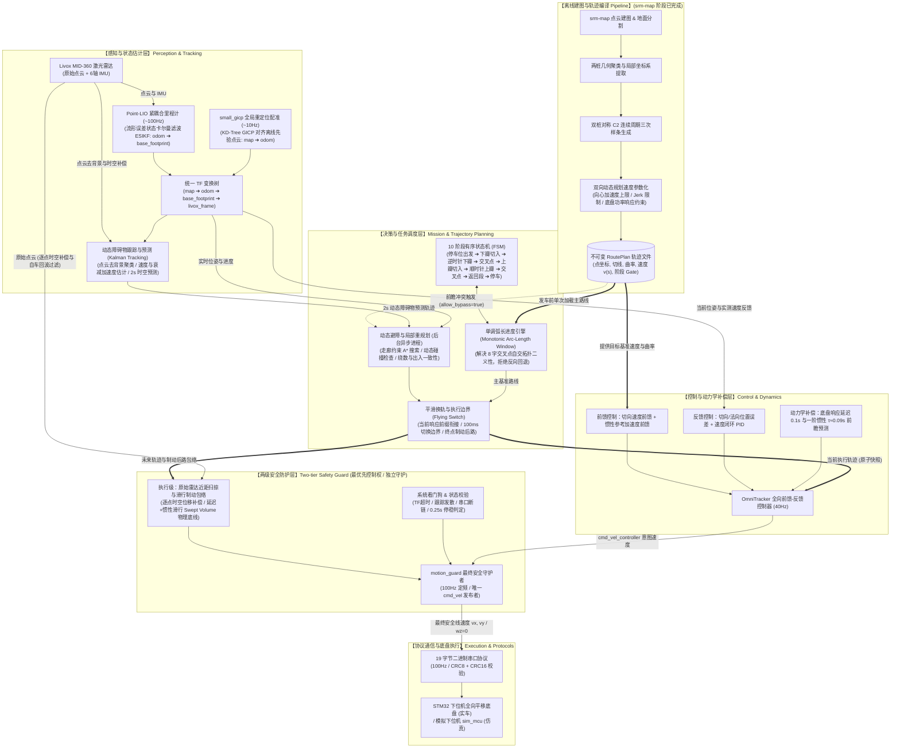

# SRM 校内赛自主导航

基于公开项目 [pb2025_sentry_nav](https://github.com/SMBU-PolarBear-Robotics-Team/pb2025_sentry_nav)，实现从停车位出发、逆时针绕下桩、顺时针绕上桩、沿原路回位的自主导航。支持障碍停车、移除恢复、持续障碍绕行、输入失效保护和比赛串口协议。

2026-10-20 的实车冻结基线：**9.440 秒完成 10 个有序分段，0 次障碍阻断**。参数和源码指纹见[基线记录](docs/results/2026-10-20/baseline-9s440.json)，冻结标签为 `baseline/field-9s440`。这是单次现场记录，位置和速度来自车载定位；新场地会重新建图、识桩并规划，不能直接套用旧地图或成绩。18.554 秒旧版保留为历史标签 `baseline/field-18s554`。

当前 `main` 已合入[预测绕行候选](docs/architecture/trajectory-avoidance.md)，绕行默认关闭（`allow_bypass=false`）。该候选的重放和仿真结果不代表新增实车验收通过；实车冻结版本仍由上述基线标签保留。

现场执行 `srm-map → srm-nav sensors → srm-nav drive → srm-nav start`；可在发车前执行 `srm-nav prepare`，将路线计算与发车分开。操作见[命令手册](docs/field-cli.md)，实现见[整圈轨迹导航](docs/architecture/trajectory-navigation.md)。

控制后端可用[PB / MPPI 离线对照](docs/architecture/controller-comparison.md)在相同地图、路线和执行模型上比较；[底盘响应测量](docs/vehicle/response-measurement.md)提供旧实车日志复用、自动采样、拟合和后续实车测试命令。

## 项目架构



- **离线轨迹编译（L0）**：`srm-map` 完成点云建图与地面分割后，自动聚类两桩并建立对称局部坐标系，生成曲率连续的 $C^2$ 周期三次样条，利用双向动态规划综合向心加速度、Jerk 与底盘功率响应约束生成不可变的 `RoutePlan` 轨迹。
- **感知与状态估计（L1）**：Livox MID-360 采集点云与 6 轴 IMU；Point-LIO（~100Hz）通过流形误差状态卡尔曼滤波（ESIKF）估计连续里程计，small_gicp（~10Hz）利用 KD-Tree GICP 对齐离线先验点云发布重定位修正，维护统一坐标树 `map → odom → base_footprint → livox_frame`。原始点云在去背景与时空补偿后，经卡尔曼滤波跟踪器估计目标速度与衰减加速度，输出带时间维度的 2s 动态目标预测。传感器模式不使用 Gazebo 真值。
- **决策与任务调度（L2）**：10 阶段状态机（FSM）覆盖从车位出发、双瓣绕行到原路回位全流程；单调弧长进度引擎在自交 8 字交叉点提供局部单调窗口，从几何拓扑上根除二义性与反向回退。启用避障候选时（`allow_bypass=true`），后台异步规划器在原任务走廊、双瓣绕数及出入一致性约束下执行走廊 A* 与平滑求解，并通过 Flying Switch（100ms 动态边界）衔接响应前缀实现平滑换轨与制动后路保留；障碍移除后自动恢复。
- **控制与动力学补偿（L3）**：OmniTracker（40Hz）融合切向速度与惯性参考加速度前馈、切向/法向位置与速度闭环 PID 反馈，并显式引入底盘响应延迟（0.1s）与一阶惯性（$\tau \approx 0.09s$）的前瞻预测，消除高速弯道漂移。
- **两级安全防护与仲裁门禁（L4 / 顶层守护）**：实行两级分治安全原则——规划级负责 2s 时空防撞与绕行候选认证；执行级 `motion_guard`（100Hz）拥有系统最优先控制权，是速度指令的唯一发布出口，旁路接收原始点云并进行自车回波与判障高度过滤，结合底盘延迟与惯性滑行对预测轨迹做 Swept Volume 扫掠检测，并由系统看门狗执行 TF 时效、跟踪发散与连续 0.25s 停稳多重守护。
- **通信协议与底盘执行（L5）**：经严格校验的 19 字节二进制串口协议（100Hz / CRC8+CRC16）下发线速度（$v_x, v_y$，$w_z \equiv 0$）；实车直连 STM32 下位机全向平移底盘，仿真环境通过伪终端驱动 `sim_mcu` 模拟下位机，保证虚实链路同构。
- **场景与模型**：使用 [赛方圆柱哨兵模型](simulation/models/sentry_robot_cylinder.xacro)和公开 MID-360 资源，导航包络半径 0.29 m。场地几何、速度和容差统一在 [arena.json](config/arena.json)。详情见[整圈轨迹导航](docs/architecture/trajectory-navigation.md)。

| 目录 | 作用 |
|---|---|
| [intramural_mission](nav_ws/src/intramural_mission/) | 有序任务、绕行、仿真点云适配和速度保护 |
| [intramural_base](nav_ws/src/intramural_base/) | CRC、串口协议、底盘桥、模拟下位机和 ROS 清理 |
| [launch](launch/)、[config](config/) | 启动组合、场地参数、通信与车辆配置 |
| [scripts](scripts/README.md)、[tests](tests/) | 构建、运行、诊断和验收 |
| [docker](docker/)、[patches](patches/README.md) | Humble 环境、固定源码及公开修复 |
| [docs](docs/) | 技术细节、调试日志与精选结果 |

9 个顶层公开依赖以 Git 子模块登记，递归包含 pb2025 的 7 个子模块；small_gicp 和 Livox SDK 源码由准备脚本下载到 `cache/`。版本和 5 个修复补丁由 [sources.lock.json](docker/sources.lock.json) 固定。克隆后必须执行源码准备，GitHub 源码 ZIP 不含子模块内容。许可证与来源见 [THIRD_PARTY](THIRD_PARTY.md)。

## 开发机准备

开发环境为 Ubuntu 22.04 / ROS 2 Humble / Ignition Fortress。WSL2 使用 Docker、WSLg 和 GPU 渲染；需要 Docker 可用及桌面显示接口。环境和渲染细节见[环境说明](docs/deployment/environment.md)与 [GPU 配置](docs/deployment/gpu.md)。

```bash
git clone --recurse-submodules git@github.com:Alkapuce/srm-intramural-navigation.git
cd srm-intramural-navigation
python3 scripts/prepare-sources.py
python3 scripts/sources.py status
scripts/build-image.sh
scripts/build-workspace.sh
scripts/check-environment.sh
```

源码准备按公开提交恢复并校验补丁，遇到额外改动会停止。默认 ROS domain 为 71，Ignition partition 为 `srm_intramural`；同一套任务的所有终端使用一致配置，同一时刻只启动一套仿真。

## 仿真运行

在项目根目录启动传感器定位和完整串口模拟链：

```bash
scripts/candidate.sh serial-sim
```

窗口加载后系统待机。另开终端进入同一项目，查看状态；`ready=true` 后结束状态订阅，再启动任务：

```bash
scripts/run.sh ros2 topic echo /intramural_robot/mission/status
scripts/run.sh ros2 service call /intramural_robot/mission/start std_srvs/srv/Trigger '{}'
```

任务依次执行入场、下瓣、上瓣和返回；`DONE` 表示任务完成。取消和复位：

```bash
scripts/run.sh ros2 service call /intramural_robot/mission/cancel std_srvs/srv/Trigger '{}'
scripts/run.sh ros2 service call /intramural_robot/mission/reset std_srvs/srv/Trigger '{}'
```

复位不传送机器人，运行中拒绝复位。普通 `start` 要求位于停车位；调试命令 `srm-nav start-here` 可从地图中已正确定位的当前位置接入完整八字，最终回原停车位，不继承上轮进度。在主启动终端按 `Ctrl-C`，等待所有子进程正常退出。

| 入口 | 用途 |
|---|---|
| `scripts/candidate.sh simulation` | 理想定位，排查路线和任务逻辑 |
| `scripts/candidate.sh navigation` | 仿真点云/IMU定位，直接驱动仿真底盘 |
| `scripts/candidate.sh serial-sim` | 同一传感器定位链，速度经过模拟串口 |
| `scripts/arena-obstacle.sh place --x 1.5 --y 1.5` | 在场景中放入干扰箱；`park` 移回 |

几何、速度和容差统一在 [arena.json](config/arena.json)，派生场景、地图和路线生成到 `simulation/generated/`。任务状态、参数及绕行约束见[仿真说明](docs/simulation/arena-mission.md)；上游对照场景的数据流见[导航基线](docs/architecture/navigation-dataflow.md)。

## 自动复现与验收

以下入口在开发机 Docker 环境执行，输出目录必须使用新名称。

```bash
# 当前测试
scripts/run.sh python3 -m unittest discover -s /work/tests -v

# 传感器定位 + 模拟串口：全圈、取消、复位和退出
scripts/verify-stage34.sh --mode sensors --transport serial-sim --rounds 1 \
  --output /work/artifacts/recheck-sensors-01

# 轨迹避障候选：模型、历史影子重放、刚体及故障验收
scripts/verify-avoidance.sh --suite all \
  --output artifacts/recheck-avoidance-01

# 独立 build/install：完整构建、测试与传感器串口路线
scripts/reproduce-candidate.sh --output /work/artifacts/reproduce-01
```

`/work/artifacts/` 对应本机项目的 `artifacts/`。验收保存轨迹、结果、配置快照和子进程退出状态；无窗口模式仍需图形设备渲染雷达。其他故障、建图和诊断入口见[脚本索引](scripts/README.md)。高速整圈引擎的候选动态绕行、独立验收及已知限制见[轨迹避障说明](docs/architecture/trajectory-avoidance.md)，目前须显式启用。

| 已验证场景 | 结果 |
|---|---|
| 传感器定位、理想定位各五圈 | 全部完成；传感器回位误差 2.13–3.09 cm |
| 入口、下瓣、上瓣、交叉点障碍 | 持续绕行与移除恢复通过，有序进度和原路返回均检查 |
| 取消、输入停更、无路可走 | 停机及状态转换通过；物理断链仍暴露停机缺口 |
| 干净克隆独立复现 | 31 包、60 项测试、完整串口模拟路线通过；回位误差 3.51 cm |

[调试日志](docs/debug-log.md)记录问题、排查、修复及系统理解；机器可读结果包括 [10-13 仿真](docs/results/2026-10-13/validation-summary.json)、[10-14 独立复现](docs/results/2026-10-14/reproduction.json)、[10-16 仿真复验](docs/results/2026-10-16/simulation.json)和 [10-16 实车任务](docs/results/2026-10-16/field-navigation.json)。不同日期与源码快照的结论分别保留。

## NUC 离线部署与调试

NUC 当前通过局域网同步代码，在宿主机原生 ROS 2 Humble 环境构建。先在开发机准备完整交付目录，再用 `rsync` 传输，保留公开依赖和 Git 元数据；同步命令、依赖核查及完整构建步骤见 [NUC 部署](docs/deployment/nuc.md)。

NUC 完成全量构建后，在桌面终端运行同一套仿真：

```bash
cd ~/workspaces/srm/intramural
export INTRAMURAL_NATIVE=1
scripts/candidate.sh serial-sim
```

另一个终端使用相同变量，按前述 `start/cancel/reset` 操作。实车 MID-360 和 Point-LIO 的调试入口是 `scripts/vehicle-sensors.sh`；它只启动传感器，不启动底盘或任务。参考参数、配置生成和真实串口接入见[实车接口](docs/vehicle/reference.md)与[接车调试](docs/vehicle/commissioning.md)。

在 NUC 仓库根目录执行 `scripts/install-cli.sh` 注册个人全局命令。`srm-map` 覆盖场地后停在本次起始位置，按 Enter 自动校验、导图、重定位并记录当前车位，随后识别两桩，联合生成平滑的整圈路线与速度曲线；支持 `--duration` 定时和 `--bag` 复用。生成配置后，分别运行 `srm-nav sensors` 与 `srm-nav drive`，再用第三终端 `start` 或 `start-here` 发车。默认选择最新有效图，也可传入路径固定版本。操作见[现场手册](docs/field-cli.md)，几何与速度联合搜索、执行模型及结果见[整圈轨迹导航](docs/architecture/trajectory-navigation.md)。

建图结束显示保存位置，并自动将地图、路线和速度曲线 PNG 导出到 `artifacts/.png/`；`srm-nav preview` 可随时只读重导。终端仅打印文件位置，不要求图形桌面。

分步建图与锁定待机的 TF 接线见[实车导航待机](docs/vehicle/navigation-standby.md)；默认待机不打开串口，显式 `drive` 才启用已确认配置的底盘通信。正式场地需现场重新建图、确认桩位和配准；本次 1:1 速度初值尚未做定量测速。模拟下位机刻意没有超时停车，断链后可能继续执行末帧；上位机看门狗不能替代下位机或硬件停机机制。
