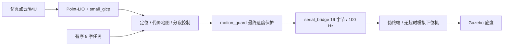

# SRM 校内赛导航赛道

本仓库实现算法组导航赛道的有序 8 字任务、Point-LIO + small_gicp 传感器定位、速度保护和 19 字节串口协议。以公开项目 `pb2025_sentry_nav` 为基线，支持双运行环境：

- **开发与仿真端（WSL2 笔记本）**：运行于 Ubuntu 22.04 / ROS 2 Humble / Ignition Fortress Docker 容器，提供带 GPU 硬件加速的 8 字仿真场景、Nav2、传感器闭环与测试套件。
- **实车运行端（Intel NUC 工控机）**：运行于宿主机**原生 ROS 2 Humble**（无需 Docker、无需 sudo 权限），代码通过本地局域网 `rsync` 纯净传输，原生编译并对接实车 Mid-360 雷达与下位机串口。

**赛方圆柱哨兵模型接入及本机范围验收已完成：59 项测试、31 包独立构建，两种定位模式各连续五圈 GUI/模拟串口、四处持续障碍绕行和原路回位、移除恢复及故障注入均已验收。结果见[模型接入验收](docs/validation.md)。NUC 硬件、实车地图、安装标定、固件兼容和物理断链停车仍待接车确认。**

仓库地址：[Alkapuce/srm-intramural-navigation](https://github.com/Alkapuce/srm-intramural-navigation)，可见性为 **private**。[规则](算法组校内赛规则/rules.md)要求上传 GitHub 并供代码检查，未明确必须设为 public；提交验收前须向赛务确认访问方式并提供读取权限。凭据不放入代码或 README。

[中期要求](算法组校内赛规则/中期测评流程及成果提交要求.md)算法部分要求在 **2026-10-17 之前**将链接发给指定赛务联系人，调试日志和效果展示可作为补充。评审入口、源码范围、复现命令与尚未完成的实车工作见[中期提交说明](docs/midterm-submission.md)。

2026-09-30 现场核对事实：拟使用上赛季 SRM 哨兵车（麦轮底盘），赛方尚未完成配置与正式交付。实测 NUC 系统为 Ubuntu 22.04 LTS，赛方已在宿主机预装 ROS 2 Humble 与 colcon；用户 `qpj` 拥有 `dialout` 串口权限但**无 sudo 权限**（比赛规则禁止修改系统配置），且现场 NUC 处于离线状态。已核对的队内历史参数仅作接车初值，比赛规则与导航协议优先；详见[实车参考说明](docs/vehicle-reference.md)；现场照片和草稿保留在本机 `docs/09_30real_debug/`，不随仓库分发。

## 1. 仓库范围与系统流程

| 纳入 Git | 留在本机、排除 Git |
|---|---|
| 自有 `intramural_mission`、`intramural_base` 包 | 个人设备配置和现场数据 |
| 9 个公开依赖的固定 Git 子模块，含 pb2025 的 7 个递归子模块 | 第三方本机修复分支的未发布提交、额外下载 |
| `launch/`、参考配置、依赖锁和公开补丁 | `cache/`、ROS build/install/log、派生场景 |
| 部署/调试入口、回归测试、说明和规则资料 | 地图、rosbag、原始运行日志、core、个人设备配置 |
| 有来源的少量验证 JSON 摘要 | 相邻队内源码；本地现场草稿及照片 `docs/real_debug/`、`docs/09_30real_debug/` |

第三方项目通过 [.gitmodules](.gitmodules) 直接链接公开固定提交，克隆时递归下载完整源码和许可证，再用 `prepare-sources.py` 应用校验补丁。NUC 不需要拉取本机未发布的修复分支。GitHub 的源码 ZIP 不包含子模块内容，请按下方 Git 克隆或完整离线同步流程部署。依赖来源见[第三方说明](THIRD_PARTY.md)。开发计划、Agent 约定、内部维护说明及原始现场资料仅留本机。



实车传感器入口使用 MID-360 驱动提供的真实点内时间，不使用仿真 `lidar_adapter`；实车串口接口沿用同一独立协议实现。

## 2. 部署到 NUC（局域网同步与环境检查）

赛场 Intel NUC 由赛务分配个人隔离用户 `qpj`。依照比赛规则，选手**无 sudo 权限**，亦严禁擅自修改共用系统级配置。

> [!IMPORTANT]
> **NUC 环境记录（2026-09-30）**：本轮未连接 NUC，部署前仍须按 2.3 核查当前状态。
> 1. **无需 Docker，也无 sudo 权限**：NUC 未预装 Docker，普通用户无法安装守护进程；但 NUC 宿主机已由赛务预装了 **原生 ROS 2 Humble**（`/opt/ros/humble`）与 `/usr/bin/colcon`，代码可直接原生构建与执行。
> 2. **串口与网络权限记录**：用户 `qpj` 属于 `dialout` 组，对下位机串口 `/dev/ttyACM0` 有读写权限；有线网口 `enp86s0` 预设了静态 IP `192.168.1.50/24`（无网关）。接线后仍须核查当前权限、连接和真实点云，不能用配置存在代替实际数据验证。
> 3. **现场离线无外网**：NUC 无法直接访问 GitHub，部署优先使用局域网传输，避免依赖外网或在公用机暴露 GitHub 凭据。

### 2.1 方案 A（推荐）：从笔记本 WSL2 局域网高速推送到 NUC

在笔记本开启个人热点（或连接同一路由器），笔记本与 NUC 组建局域网（例如 NUC IP 为 `10.161.105.105` 或 `192.168.43.x`）。

在**笔记本 WSL2 终端**先创建只含对外交付内容的克隆，再同步到 NUC。克隆保留公开依赖及版本信息，不会带入本地计划、约定和现场草稿：

```bash
# 1. 测试连通性并配置免密登录（只需一次）
ping -c 3 10.161.105.105
ssh-copy-id qpj@10.161.105.105

# 2. 从已整理的 main 创建干净交付目录（目录必须尚未存在）
cd /home/qpj/workspaces/srm/intramural
project_root="$PWD"
delivery_root="$project_root/artifacts/deployment/midterm-source"
git clone --no-local --single-branch --branch main --recurse-submodules \
  "$project_root" "$delivery_root"
cd "$delivery_root"
python3 scripts/prepare-sources.py
python3 scripts/sources.py status

# 3. 单向同步干净交付目录
ssh qpj@10.161.105.105 'mkdir -p ~/workspaces/srm/intramural'
rsync -avz --progress \
  --include='/cache/' \
  --include='/cache/small_gicp/***' \
  --exclude='/cache/***' \
  --exclude='/docs/real_debug/***' \
  --exclude='/docs/09_30real_debug/***' \
  --exclude='artifacts' \
  --exclude='nav_ws/build' \
  --exclude='nav_ws/install' \
  --exclude='nav_ws/log' \
  --exclude='simulation/generated' \
  --exclude='/config/local/***' \
  --exclude='.env*' \
  --exclude='__pycache__' \
  --exclude='core' --exclude='core.*' \
  "$delivery_root/" qpj@10.161.105.105:~/workspaces/srm/intramural/
```

此命令保留根仓库和子模块 Git 元数据，用于离线核对版本；递归克隆的子模块 `.git` 文件引用根 `.git/modules/`，不能单独排除根 `.git`。传输前停止两端运行，检查根 `git status` 和 `python3 scripts/sources.py status`；已有 NUC 工作目录有个人修改时先保留，首次部署优先使用新目录。不要传输 Home 中的 SSH 密钥、GitHub 凭据或凭据缓存。

### 2.2 方案 B（备用）：有外网时通过 GitHub 克隆

若赛务后续提供了外网连接，且已在 NUC 配置了个人 SSH Key：

```bash
ssh -T git@github.com
mkdir -p ~/workspaces/srm
git clone --recurse-submodules git@github.com:Alkapuce/srm-intramural-navigation.git ~/workspaces/srm/intramural
cd ~/workspaces/srm/intramural
python3 scripts/prepare-sources.py
python3 scripts/sources.py status
```

### 2.3 在 NUC 上核查只读环境

SSH 登录 NUC 或在桌面终端执行：

```bash
id                         # 确认输出包含 groups=...20(dialout)
uname -m                   # x86_64
cat /etc/os-release        # Ubuntu 22.04 LTS (Jammy)
which ros2 colcon python3  # 确认 /opt/ros/humble/bin/ros2 与 /usr/bin/colcon
ls -l /dev/ttyACM*         # 确认下位机串口 (crw-rw---- 1 root dialout)
ip -br address             # 确认 enp86s0 (192.168.1.50/24)
```

## 3. 工作区构建与单元测试

根据运行目标选择对应的构建与测试方式：

### 3.1 NUC 实车原生构建与测试（直接在宿主机执行）

在 NUC 桌面终端登录 `qpj` 用户，使用宿主机预装的 ROS 2 Humble 和 colcon 编译：

第 2 节必须先恢复固定公开源码。编译依赖还包括公开 Livox SDK2、PCL、Eigen 和 glog，不能仅凭 ROS/colcon 存在认定齐备；环境缺项先在个人前缀准备或请赛务协助，依赖版本和构建依据见 [Dockerfile](docker/Dockerfile)。本轮没有连接 NUC 重新确认这些依赖。

```bash
cd ~/workspaces/srm/intramural/nav_ws
source /opt/ros/humble/setup.bash

# 编译核心参赛包与驱动（Release 优化模式）
colcon build --symlink-install \
  --packages-select intramural_base intramural_mission livox_ros_driver2 point_lio \
  --cmake-args -DCMAKE_BUILD_TYPE=Release

# 加载已构建的核心工作空间（完整测试请先完成下方全量构建）
source install/setup.bash
```

> **历史现场记录**：2026-09-30 NUC（i7-1360P）四个核心包编译及当时 45 项测试通过。该构建范围不包含完整仿真；当前全部测试还依赖 `sensor_scan_generation` 等公开包，本轮未在 NUC 重新验收。

### 3.2 WSL2 本机开发端构建（Docker 容器仿真环境）

在笔记本 WSL2 终端执行（首次需要外网下载依赖镜像与子模块）：

```bash
python3 scripts/prepare-sources.py
scripts/build-image.sh
scripts/build-workspace.sh
scripts/check-environment.sh
scripts/run.sh python3 -m unittest discover -s /work/tests -v
```

镜像为 `intramural-humble:stage2`，9 个公开仓库和主仓库子模块由 `docker/sources.lock.json` 固定，三个公开修复通过 `patches/` 恢复。

### 3.3 通信域隔离（现场调试必配）

共用网络下，同一局域网的多台机器可能发生 ROS 2 话题串扰。必须按现场分配设置独立 Domain ID，并在所有终端一致设置：

```bash
export INTRAMURAL_ROS_DOMAIN_ID=71
export INTRAMURAL_IGN_PARTITION=srm_intramural
# 71 为本项目默认值；与他人冲突时改为约定的个人值。
```

## 4. 在 NUC 桌面跑仿真

仿真需要全部公开依赖，四个核心包构建不能替代它。先在 NUC 桌面确认 ROS、Ignition Fortress、图形及 Python 依赖；缺少的依赖只在个人用户前缀准备，或请赛务协助，不修改共用系统设置：

```bash
source /opt/ros/humble/setup.bash
ign gazebo --versions
glxinfo -B
python3 -c 'import xacro, numpy, scipy'
ros2 pkg prefix ros_gz_sim
ros2 pkg prefix nav2_controller
```

按第 2 节同步完整公开源码和 `cache/small_gicp` 后，在 NUC 构建完整工作空间：

```bash
cd ~/workspaces/srm/intramural/nav_ws
colcon build --symlink-install --parallel-workers 2 \
  --cmake-args -DCMAKE_BUILD_TYPE=Release -DBUILD_TESTING=OFF \
  -DFETCHCONTENT_SOURCE_DIR_SMALL_GICP="$PWD/../cache/small_gicp"
source install/setup.bash
python3 -m unittest discover -s ../tests -v
cd ..
export INTRAMURAL_NATIVE=1
scripts/candidate.sh navigation
```

此入口启动 Gazebo、模拟雷达/IMU、Point-LIO + small_gicp 和任务节点，待机时不自动开始行驶。先等待窗口加载，并确认点云持续更新和任务 `ready=true`；窗口出现本身不能证明传感器链可用。在第二个桌面终端进入同一 clone、设置相同 domain/partition，调用：

```bash
scripts/run.sh ros2 service call /intramural_robot/mission/start std_srvs/srv/Trigger '{}'
scripts/run.sh ros2 topic echo /intramural_robot/mission/status
```

机器人依次驶入、逆时针绕下桩、顺时针绕上桩、沿原路回停车位。运行期间查看 `phase`、`segment`、`state`；`DONE` 表示任务完成。暂停/复位与调试命令：

```bash
scripts/run.sh ros2 service call /intramural_robot/mission/cancel std_srvs/srv/Trigger '{}'
scripts/run.sh ros2 service call /intramural_robot/mission/reset std_srvs/srv/Trigger '{}'
scripts/run.sh ros2 topic echo /intramural_robot/cmd_vel
scripts/run.sh ros2 run tf2_ros tf2_echo map base_footprint --ros-args -r /tf:=/intramural_robot/tf -r /tf_static:=/intramural_robot/tf_static
```

复位不传送机器人，运行中和取消等待期间不能复位，再次启动要求机器人处于停车位。校内赛仿真坐标链为 `map→odom→base_footprint`；命名空间内 TF 查看时需按上例 remap。

在启动终端按 `Ctrl-C`，等待生命周期和所有子进程正常退出。不要用关闭整个终端、`kill -9` 或强删容器替代退出检查。

| 入口 | 用途 |
|---|---|
| `scripts/candidate.sh simulation` | 真值定位，用于任务排查 |
| `scripts/candidate.sh navigation` | 仿真传感器定位，默认桌面模式 |
| `scripts/candidate.sh serial-sim` | 完整速度路径经串口伪终端、模拟 MCU，再驱动 Gazebo |
| `scripts/candidate.sh mapping --output /work/artifacts/nuc/map-01` | 一圈仿真传感器地图汇总，仍借助解析先验 |
| `scripts/candidate.sh diagnose --output /work/artifacts/nuc/diagnose-01` | 只读源码、包和 ROS 图诊断 |

`--no-gui` 只关闭 Gazebo 查看窗口，模拟雷达仍需图形渲染。软件/硬件渲染选择和 GUI 可用性必须分别确认。几何、速度和容差入口为 `config/arena.json`，车体来自赛方模型，安装是参考初值；场地尺寸、平面动力学和扫描仍为仿真假设。

## 5. 回归测试和日常调试

下列批量验收和独立复现入口使用容器路径，**在笔记本 WSL2 开发端执行**，输出使用尚未存在的新目录。NUC 原生运行按第 4 节启动桌面仿真、调用 start/cancel/reset 并查看状态；这些批量工具尚未迁移为 NUC 原生入口。

```bash
scripts/verify-stage34.sh --mode sensors --rounds 1 --output /work/artifacts/nuc/sensors-01
scripts/verify-stage34.sh --mode ideal --rounds 1 --output /work/artifacts/nuc/ideal-01
scripts/verify-stage6.sh --scenarios entry --blocked-hold-seconds 1.5 --output /work/artifacts/nuc/obstacle-01
scripts/verify-stage6.sh --persistent --output /work/artifacts/nuc/bypass-01
scripts/reproduce-candidate.sh --output /work/artifacts/nuc/clean-01
```

最后一个入口使用独立 build/install/log 目录构建，再运行测试和完整传感器串口模拟路线，不删除当前安装。故障、上游回归和其他入口见[脚本索引](scripts/README.md)。

```bash
scripts/run.sh ros2 node list
scripts/run.sh ros2 topic list -t
scripts/run.sh ros2 topic hz /intramural_robot/livox/lidar
scripts/run.sh ros2 run tf2_ros tf2_echo map base_footprint --ros-args -r /tf:=/intramural_robot/tf -r /tf_static:=/intramural_robot/tf_static
```

话题/帧的实际名称以 `ros2 topic list -t` 与 TF 输出为准；[任务说明](docs/arena-mission.md)记录了各输入与唯一控制来源。容器运行日志在 `nav_ws/log/runtime/`，验收证据在 `artifacts/`，均属于当前 clone 的用户。

## 6. 实车 MID-360 和 Point-LIO 调试

实车调试在 NUC 桌面终端进行，车体必须**架空悬空**（麦轮离地至少 3cm，遥控器安全员双手握持遥控器，食指搭在右拨杆上，随时准备推回 MID 急停）。

先确认雷达物理连接与网络：

```bash
ip -br address             # 确认 enp86s0 已获得 192.168.1.50
ping -c 3 192.168.1.184    # 队内 Mid-360 默认 IP（若不通尝试 192.168.1.119 或按机身标签 SN 核对）
```

`192.168.1.50`（主机）和 `192.168.1.184`（雷达）来自参考提交，必须按现场确认；不把地址或外参存在于文件当作当前车辆已验证。

### 6.1 生成实车独立配置文件

```bash
# NUC 原生直接执行（生成到 cache/vehicle-srm-reference）
python3 scripts/prepare-vehicle.py \
  --output cache/vehicle-srm-reference \
  --host-ip 192.168.1.50 --lidar-ip 192.168.1.184
```

### 6.2 启动实车雷达与 Point-LIO

```bash
# 方式 1：NUC 原生执行（推荐）
source /opt/ros/humble/setup.bash
source nav_ws/install/setup.bash
ros2 launch launch/vehicle-sensors.launch.py \
  vehicle_config:=$(pwd)/cache/vehicle-srm-reference

# 方式 2：使用启动脚本（自动检测并兼容原生环境）
scripts/vehicle-sensors.sh
```

此入口启动公开 Livox 官方驱动（`xfer_format=1`，输入为 LivoxCustomMsg）和 Point-LIO，不启动底盘、任务或速度发布节点。真实扫描时间由驱动提供，不通过仿真适配器重造。生成配置的外参仍是待测参考。

生成器拒绝覆盖已有目录。再次生成时改用新的 `cache/<目录>`，并传入对应 `vehicle_config` 参数；下方串口命令的 calibration 路径也要相应调整。

### 6.3 检查数据流与频率

另开终端核验消息类型与持续更新频率：

```bash
source /opt/ros/humble/setup.bash
ros2 topic info /livox/lidar -v
ros2 topic hz /livox/lidar                           # 参考约 10 Hz
ros2 topic hz /livox/imu                             # 参考约 200 Hz
ros2 topic hz /intramural_robot/aft_mapped_to_init   # Point-LIO 位姿估计
ros2 topic hz /intramural_robot/cloud_registered     # 去畸变点云
```

参考发布频率为点云 10 Hz、IMU 200 Hz；还应确认时间单调、单位、静止姿态和输出是否合理。频率正常不能替代外参/定位质量验收。用 `Ctrl-C` 结束传感器入口。真实 bag 只留在本机；没有完成真实设备验证前，不称为实车定位链已通过。

RViz 可使用 `ros2 run rviz2 rviz2`，添加实际点云话题并选择对应 fixed frame；该传感器入口输出 Point-LIO 的 `camera_init`/`body`，尚未组成实车 `map→odom→base_link` 导航链。安装外参、参考固件冲突和详细来源见[实车参考说明](docs/vehicle-reference.md)。

## 7. 实车串口和底盘通信接入

### 7.1 检查设备与权限

在 `qpj` 用户下检查串口：

```bash
ls -l /dev/ttyACM* /dev/serial/by-id/
id  # 确认输出包含 20(dialout)
```

NUC 上 STM32 主控板的虚拟串口设备通常识别为 `/dev/ttyACM0`，权限为 `crw-rw---- 1 root dialout`，`qpj` 用户已在 `dialout` 组中，无需 sudo 即可读写。

### 7.2 核心安全门禁与架空急停测试

在真实串口启动前，必须有记录证明三项安全条件：
1. **19 字节协议兼容**：含 CRC8/CRC16、包头 `0xAA 0x55`、序号与分片收帧；
2. **遥控器急停接管有效性实测**：固件无超时停车，上位机发非零速度时，遥控器安全员将右拨杆拨回 MID，轮子必须瞬间切断动力停转；
3. **底盘坐标与速度映射标定**：实际车体到协议的 $2\times2$ 映射矩阵。

对应 `base-vehicle.json` 中三个验证字段默认 false，矩阵为空；未验证时串口节点在打开设备前主动拒绝启动，报 `Vehicle validation is missing`。禁止仅为绕过拒绝而把字段盲目改为 true。遥控器拨杆与停机行为必须按实际固件现场确认。

### 7.3 启动通信节点

完成上述验证后，通信层入口为：

```bash
# NUC 原生执行
source /opt/ros/humble/setup.bash
source nav_ws/install/setup.bash

ros2 run intramural_base serial_bridge --ros-args \
  -r __ns:=/intramural_robot \
  -p simulation:=false \
  -p device:=/dev/ttyACM0 \
  -p calibration:=$(pwd)/cache/vehicle-srm-reference/base-vehicle.json
```

未验证配置会在打开设备前报 `Vehicle validation is missing`，这是预期拒绝。通信节点不是完整导航启动文件。赛方模型已接入，但仍需核对它与实物的轮廓和安装，准备现场地图、TF 唯一发布者、真实时间语义、定位初始化和低速动力学验收，并把最终 `motion_guard → serial_bridge` 设为唯一速度出口；不得把 `arena-navigation.launch.py` 的仿真时钟、平面驱动或解析先验直接用于实车。

已有仿真证实：无下位机超时停车时，物理断链后 MCU 可能继续执行末帧，即使上位机已经取消并输出零速。详情见[接车边界](docs/prevehicle-candidate.md)。

## 8. 更新、回退与常见问题

更新前先正常结束运行，在当前 clone 保留自己的修改，再操作根仓库：

```bash
git status --short
git fetch origin
git pull --ff-only
git submodule update --init --recursive
python3 scripts/prepare-sources.py
python3 scripts/sources.py status
```

当前固定基线不升级时，以上命令保留已经应用的补丁。若后续更新改变依赖基线，先核对并处理旧补丁，不能强制覆盖子模块修改；公开源码的修改、导出与基线切换见[补丁说明](patches/README.md)。离线 NUC 使用第 2.1 节同步流程，并先保留两端个人改动。

| 现象 | 检查与处理 |
|---|---|
| NUC 离线无法克隆 GitHub | 在笔记本 WSL2 终端执行 `rsync -avz ... qpj@<NUC_IP>:~/workspaces/srm/intramural/` 局域网推送，秒级同步且不泄露凭据 |
| NUC 无 Docker / 无 sudo 权限 | NUC 宿主机已预装原生 ROS 2 Humble 与 colcon，直接使用原生 `source /opt/ros/humble/setup.bash`，无需 Docker 与 sudo |
| 串口权限不足 (Permission denied) | 运行 `id` 确认是否在 `dialout` 组；赛方已为 `qpj` 开通该权限 |
| Ping 不通 Mid-360 雷达 | 确认雷达已供电、网线已接紧；核查 `ip -br address` 确认 `enp86s0` 获得 `192.168.1.50/24` |
| `Vehicle validation is missing` | 防炸车安全门禁生效；须在架空条件下完成协议、急停接管及底盘标定测试，保留默认拒绝 |
| private clone 被拒绝 | 核对 GitHub 账号/仓库权限和该个人用户的 SSH 身份；不在 URL 中写凭据 |
| `Cannot open display` / 图形鉴权失败 | 在桌面终端核对 DISPLAY、Xauthority；脚本自动只读映射 |
| TF 停更 / FAULT | 保留日志、时间戳和资源负载；定位输入恢复后按任务条件复位，不放宽失效保护来掩盖问题 |
| 退出异常 | 保留子进程退出码和日志，不将重跑正常视为根因已修复 |

## 9. 验证状态与资料

本机历史结果包括 31 包独立构建、传感器/理想定位各连续五圈、串口闭环完整路线、障碍停车及移除恢复、断链边界测试。本轮容器入口改动另有回归记录。Git 中只保留[精选调试结果](docs/validation.md)，原始日志、轨迹和冻结清单留在原机器 `artifacts/`，fresh clone 不自动获得它们。

持续障碍绕行先停车，移除后恢复；持续阻挡后尝试受有序进度与绕数约束的绕行，入口发生绕行后沿已走入场路径返回，无路可走保持停车。2026-10-13 的最终矩阵全部通过，传感器定位五圈回位误差 2.13–3.09 cm；场景和 GUI 实际显示已复核，最新版本、结果与边界见[模型接入记录](docs/validation.md)及[机器可读证据](docs/results/2026-10-13/validation-summary.json)。

此前的点云丢帧、初始重力方向错误、消息同步额外延迟和 Python 节点退出异常分别有对照修复，失败记录保留。历史个别 C++ 退出崩溃未单独归因，当前整套矩阵及地形节点压力测试未复现，不能声称已彻底消除。`--no-gui` 验收仍使用图形设备渲染雷达；NUC 硬件运行、现场定位和实车安全均不能由 WSL 测试替代。

- [中期提交说明](docs/midterm-submission.md)、[脚本索引](scripts/README.md)
- [任务与数据流](docs/arena-mission.md)、[上游数据流](docs/navigation-dataflow.md)
- [仿真验证与问题对照](docs/validation.md)、[精选结果](docs/results/2026-10-13/validation-summary.json)
- [部署边界](docs/prevehicle-candidate.md)、[SRM 参考接口](docs/vehicle-reference.md)
- [规则](算法组校内赛规则/rules.md)、[导航协议](算法组校内赛规则/navigation_protocol.md)
