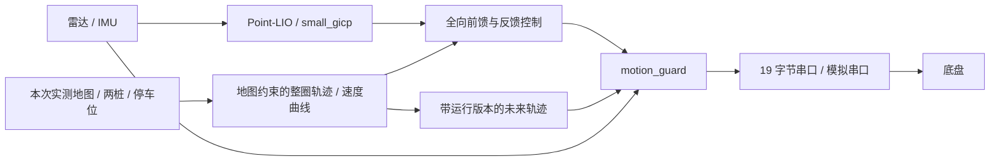
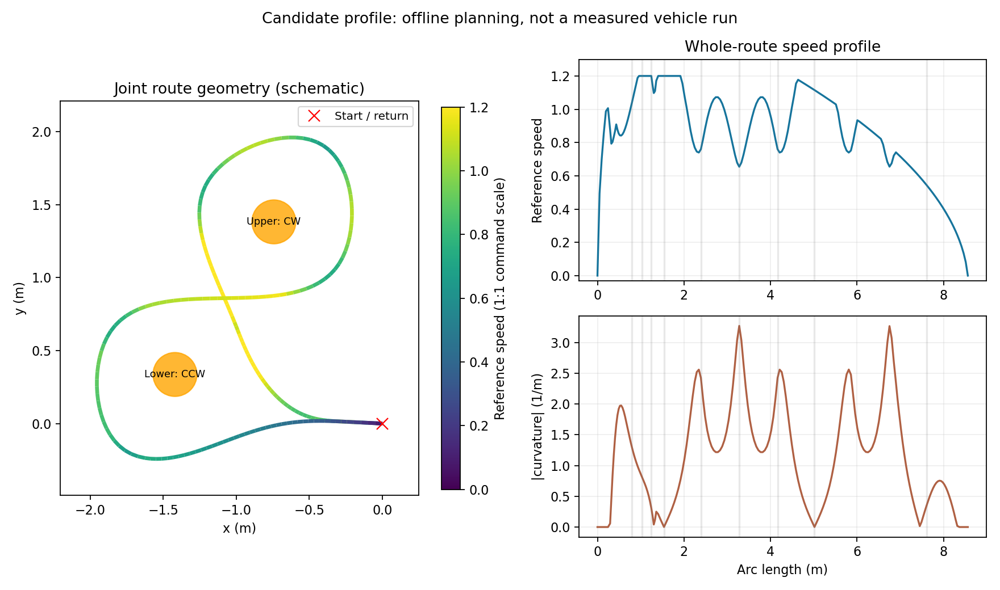

# 整圈轨迹导航

现场建图后，使用本次地图、停车位和双桩位置编译整条路线。切入、八字与返回共享几何、速度曲线和有序进度；普通阶段交接不重新发送控制目标。传感器、定位、比赛串口及底盘接口沿用现有实现。

## 数据流与所有权



`trajectory_mission` 是新引擎的唯一任务与进度所有者，直接发布 `cmd_vel_controller`。Nav2 继续提供地图、局部代价地图及生命周期服务；PB 控制器输出隔离到 `legacy_cmd_vel`，Nav2 速度平滑器不串入新控制链。最终 `cmd_vel` 仍只有 `motion_guard` 发布，串口层保留物理接口限幅和命令过期处理。

退出时先让串口桥完成回零、关闭串口并退出，再关闭其余导航节点；超时或异常退出仍报告失败。仿真与实车启动入口共用这一顺序。运行入口默认将 `OPENBLAS_NUM_THREADS` 设为 1，避免每个 Python ROS 进程为少量平面运算各自创建线程池；显式环境设置仍保留。

旧 `mission`、PB 控制器和分段 FollowPath 执行链保留在 `navigation_engine=legacy`，用于历史配置和绕行实验。新引擎当前采用障碍停车等待，不自动绕人。两种引擎由启动配置选择，不能同时运行。

| 模块 | 职责 |
|---|---|
| `planning.py` | 实测栅格、切向接入、平滑候选、净空与绕数检查 |
| `route_optimization.py` | 随桩距变化的周期样条、两瓣宽度与交叉点候选 |
| `trajectory.py` | 不可变 RoutePlan、单调弧长进度、全程速度曲线、全向跟踪 |
| `response.py` | 共享的延迟/惯性底盘模型、生产跟踪器闭环预测 |
| `trajectory_mission.py` | 启停服务、传感器时效、阻挡恢复、阶段记录 |
| `safety.py` / `adapter.py` | 实际运动延伸、未来路线扫掠、最终速度保护 |
| `route.py` | 参数化双桩八字与五次过渡几何 |

## 同一条路线贯穿执行

双桩连线确定局部坐标，按任务顺序生成 10 个语义段，适应不同桩距与桩连线朝向。`safe`、`candidate` 同时比较固定圆弧和曲率连续的周期三次样条，搜索两瓣宽度、交叉点位置、两侧接入及五次过渡尺度。宽度搜索范围由桩距、完整车体和桩底座决定，不把当前场地的固定半径带到下一场地。

当前接入点需要绕障时，先搜索已观测空闲栅格中的路径，再生成末端切向一致的样条。切入与切出按主路线的真实切线、曲率连接；正常从停车位出发时，共用出入通道并平滑返回。每个几何候选都重新计算速度曲线，再用生产跟踪器、串口限幅与响应模型预测执行，按通过检查的预测总用时选择。

地图检查保留未知区，使用完整 0.29 m 车体、静态净空、栅格量化与路径采样余量，并独立检查桩的完整底座体积，避免仅看细杆点云低估障碍。候选还须通过两瓣绕数与顺序检查。全向平移没有汽车式最小转弯半径；新样条的高曲率通过速度、加速度与执行预测判断，不按车体半径额外设置转向上限。识桩仍是几何检测，需要核对现场候选。

这是**有限候选族内、给定地图与响应模型下的联合优化**，没有证明任意场地的全局最快路线。它允许更短但更急的路线输给稍长、可高速通过的路线，也保留固定圆弧作为对照。

`safe`、`candidate` 还使用 `response_models` 中三份有效旧实车辨识结果检查模型失配：保持控制器参数和候选路线不变，只改变模拟底盘的延迟与惯性。候选按当前模型预测用时排序，选择第一条也能通过这些实测模型的路线。这样可排除仅在单一假设下能贴桩通过的候选，无需降低统一限速。三组参数来自[旧日志响应辨识](../vehicle/response-measurement.md)中的切入、人挡停及较早整圈记录；它们不能代表任意速度、电量和地面下的响应范围。

两档通过 `execution_clearance=0.03` 要求各响应模型的实际执行预测仍保留 3 cm 净空，净空已扣除车体、底座和原有静态余量。2026-10-19 首圈实车横向偏差约 9 cm，原路线在旧模型下只剩约 5 mm 预测净空，说明仅要求预测不碰撞不足以覆盖模型误差。该设置影响选路，运行时保护仍按原车体和静态余量判断，不扩大急停范围。

RoutePlan 保存点、弧长、切线、曲率、速度、静态净空和阶段 gate；运行时不在交叉点搜索整条路线的最近点。当前位置只投影到原进度附近可达的有序窗口，弧长不倒退。超过跟踪阈值的投影不会先推进阶段再报错。

生成场地配置时冻结已选几何及过渡参数，并保存 RoutePlan 和地图身份。运行时只重建、检查已选路线，不重复完整候选搜索。`start-here` 为当前位置重新编译到该主路线的平滑接入，完整执行八字、返回原停车位；它依赖正确定位，不继承旧任务进度。改变任务停车位则重新运行 `field --parking-here` 或显式传入 `--parking X Y`。

重新识桩或更换停车点时会丢弃来源配置中的旧几何缓存，再做完整搜索。仿真验收以任务实际发布的整圈路径测量偏差，挡停物体也放到本次编译路线，避免新样条被错误地拿来与旧圆弧比较。

[出发前离线检查记录](../results/2026-10-19/prelab-checks.json)保留模型外失败及传感器定位＋串口模拟整圈、障碍恢复、取消和退出结果。它们不构成新版本实车验收。

## 速度与跟踪

速度曲线先按 `sqrt(a_lat / |curvature|)` 限弯速，再作前向加速、反向减速传播，并为转弯保留矢量加速度。曲率变化率和 `max_jerk` 用于压低突变位置的参考速度；这不是对实际底盘或反馈指令加加速度的严格保证。最终停车提前按响应延迟和独立制动假设减速，中间 gate 不设零速。

跟踪指令由切向速度前馈、独立切向/法向位置反馈及滤波后的速度反馈组成。按配置响应延迟与定位年龄进行短期预测，再依据实际车头角转换为底盘 vx/vy；wz 固定为零。矢量加速度只在主控制环整形，下游保留硬限幅。明确停车会立即清除历史速度，不等待舒适减速。

[档位文件](../../config/navigation-profiles.json)是新生成配置的统一入口：

| 档位 | 合速度上限 | 矢量 / 横向加速度 | 用途 |
|---|---:|---:|---|
| safe | 0.65 | 1.2 / 0.65 | 新场地默认验证 |
| candidate | 1.2 | 2.5 / 1.4 | 完成低速检查后的提速试验 |
| gold-reference | 1.5 | 0.6 / 0.5 | 旧引擎参数对照 |

指令沿用获准的 1:1 初值，尚不能当作独立量测的物理速度。两个新档位的响应延迟 0.2 s、制动能力 0.2 m/s² 均为软件假设。候选档在较大延迟、较慢底盘响应和紧弯组合下仍可能失去跟踪；下一次实车必须从 safe 开始，利用运行日志核对响应，再比较 candidate，不能仅根据仿真时间选择最高速度。`gold-reference` 不是逐字节恢复的历史实车代码。

已提供[旧日志辨识与实车补测流水](../vehicle/response-measurement.md)，已有方向、通信、历史成绩及可辨识数据直接复用。独立[PB / MPPI 对照](controller-comparison.md)只运行离线模拟，不改变本节执行链。

联合搜索的闭环评分使用 40 Hz 控制、默认 10 Hz 位姿观测，以及纯延迟与一阶响应；位姿间隔内保持上一帧并向控制器传递真实年龄。终点发零后继续模拟延迟队列和惯性滑行，再检查停车误差、净空和绕数。`--response-model` 可导入合格的源时间辨识结果，只覆盖延迟与响应时间常数，不复制含车头方向的世界坐标增益，也不改制动参数。未提供模型时，响应时间常数默认 0.15 s。评分没有模拟原始点云保护、真人或完整定位误差，不能替代完整系统或实车验收。

在一张旧实测地图上，使用相同辨识模型与 10 Hz 位姿观测，固定圆弧预测完成 12.925 s，联合方案 11.925 s，减少约 7.7%；计时到跟踪器判定完成，随后另检发零后的滑行尾段。两者均通过模型内的绕数、净空与停车检查。联合方案搜索 32 个候选约 2.46 s，冻结参数后重建约 0.0045 s，均为本机单次记录。详见[对照数据](../results/2026-10-19/joint-planning.json)及下图。这些数字不与 18.554 s 的实车记录直接比较。



## 停车、恢复与数据失效

`IDLE → RUNNING → DONE` 是普通流程。真实障碍触发 `BLOCKED`：立即零速、保留原弧长及阻挡前的检查距离；同一未来路线的新鲜点云和局部代价地图持续清空 0.5 s 后，从原进度恢复，不重新 start。

`mission/trajectory` 将 `run_id`、`route_id`、时间戳和未来路径放在同一消息中。安全层拒绝旧运行、旧路线和过期轨迹；新引擎不会默默切回只看速度方向。扫掠首先覆盖当前运动在响应延迟内的延伸，再接入有序路线，避免把理想路径误当成底盘已经执行的路径。空点云、无效返回不刷新健康状态。未来路线以外的侧后方点不阻断，实际将经过的侧方区域仍检查。

取消进入 `CANCELLING`，先输出零速，再观察速度下降；未确认停车进入故障。最终完成要求有序余程、位置误差和估计速度同时满足条件并稳定。TF/传感器过期、跟踪超限和运行中静态地图变更均进入锁定故障，需排除原因再 reset。软件零速和定位速度估计不能替代下位机断链停车、现场停动力及独立测速。

系统没有人体语义识别。人和其他真实障碍进入未来扫掠都会触发停车；不能为了减少误停而屏蔽整类立桩或车体会经过的侧方区域。

## 生成、运行与复现

现场流程见[命令手册](../field-cli.md)。新图完成后：

```bash
# srm-map 已自动生成 navigation/ 时直接使用它；也可离线指定起点重新规划
srm-nav field artifacts/mapping/本次/map --parking 0 0 --profile safe --output cache/navigation-safe
# 两终端保持运行
srm-nav sensors
srm-nav drive cache/navigation-safe
# 第三终端：核对定位与 ready 后发车
srm-nav mission-status
srm-nav start
```

需要在地图定位待机中将当前车位设为起点时，将 `--parking 0 0` 换为 `--parking-here`。该选项核对实时发布地图与所选图一致，拒绝过期位姿或另一张图的坐标。

每次运行在 `artifacts/navigation-runs/<run_id>/` 保存源码哈希、配置、地图身份、RoutePlan 和状态日志。记录包含前馈、反馈、估计速度、弧长进度和控制计算时间；记录存在不等于实车已验收。

本机纯模型验证不打开设备：

```bash
scripts/run.sh python3 /work/scripts/validation/benchmark-trajectory.py --profile safe --output /work/artifacts/benchmark-safe
scripts/run.sh python3 /work/scripts/validation/benchmark-trajectory.py --profile candidate --output /work/artifacts/benchmark-candidate
scripts/run.sh python3 -m unittest discover -s /work/tests
```

标准场景的传感器定位及串口模拟：

```bash
scripts/verify-stage34.sh --output /work/artifacts/trajectory-sensors --mode sensors --transport serial-sim --rounds 3
```

这些试验分别验证控制模型、传感器仿真和软件传输，不能证明真实制动能力，也不能把理想定位的完成时间称为实车提速结果。
