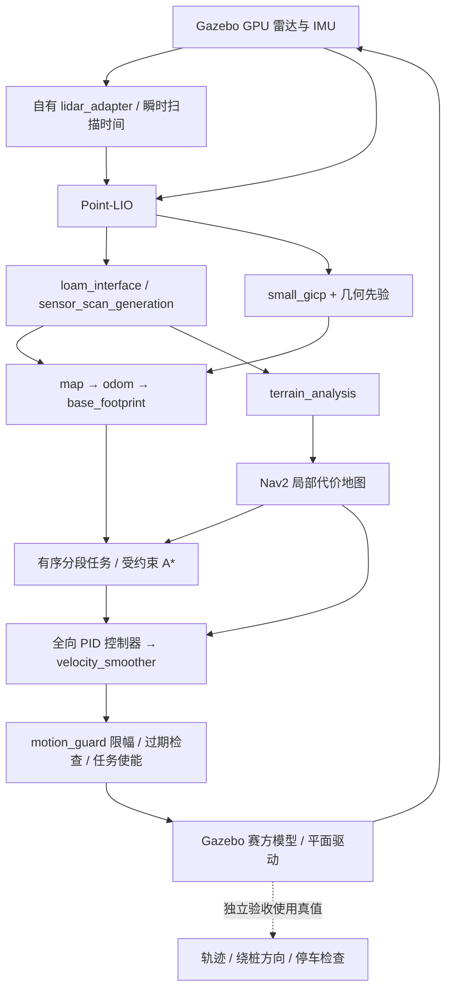
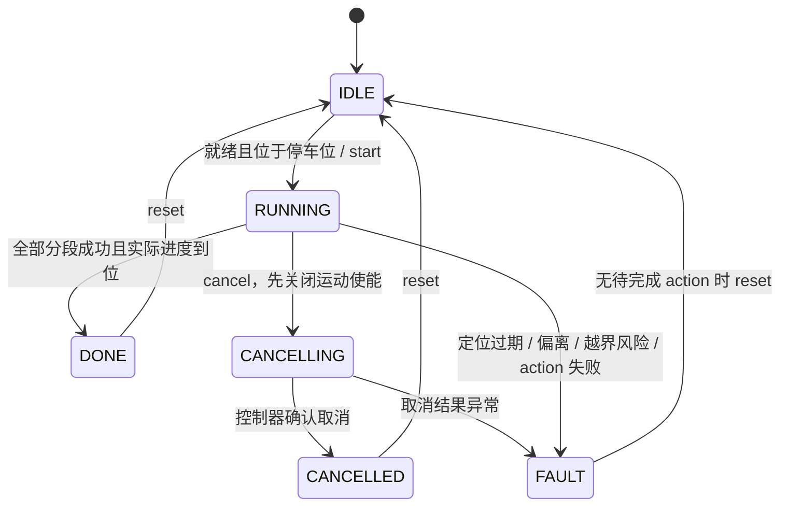

# 校内赛场景与 8 字任务使用说明

本入口在自己的电脑上运行校内赛候选导航系统。车体已使用赛方提供的圆柱哨兵 Xacro，保留圆柱、四轮碰撞和惯性；雷达安装采用 SRM 参考初值。场地尺寸、平面速度驱动和瞬时雷达扫描仍是仿真假设；地图由场景几何生成。接车后需核实安装、真实地图、底盘接口和制动性能，再验收实车。

## 启动与操作

从 `intramural/` 执行。先完成 [环境部署](environment.md)，构建工作空间：

```bash
scripts/build-workspace.sh
scripts/arena.sh --localization sensors  # Gazebo GUI，Point-LIO + small_gicp
# 初步检查任务时可改用 --localization ideal；无窗口可加 --no-gui
```

另一个终端启动任务，启动服务只在停车位内且定位和控制器就绪时接受请求：

```bash
scripts/run.sh ros2 service call /intramural_robot/mission/start std_srvs/srv/Trigger '{}'
scripts/run.sh ros2 topic echo /intramural_robot/mission/status
```

取消、复位分别执行：

```bash
scripts/run.sh ros2 service call /intramural_robot/mission/cancel std_srvs/srv/Trigger '{}'
scripts/run.sh ros2 service call /intramural_robot/mission/reset std_srvs/srv/Trigger '{}'
```

`cancel` 成功表示取消请求已受理，待状态成为 `CANCELLED` 才表示当前 action 已取消或已经结束，后续任务不会再提交。运动中拒绝复位。复位只清任务状态，不传送机器人；取消后若停在场中，再次启动会因不在停车位而被拒绝。重新开始一次全新仿真可回到初始停车位。正常结束后直接复位、启动即可连续重复。

本项目通过 `config/fastdds-services.xml` 将 Fast DDS 服务回包的 reader 发现等待设为 5 s（默认 100 ms），防止请求已发现、回包尚未匹配时丢失生命周期响应。仅覆盖服务 reply writer，普通点云、TF 和速度话题保持 ROS QoS。原生 API 复核命令为 `scripts/run.sh python3 /work/scripts/validation/verify-service-qos.py`；应输出 `response_max_blocking_time_ns: 5000000000`。这是对本项目已出现服务发现竞争的配置规避，不能断言消除了全部 DDS 故障。依据见 [Humble 回包实现](https://github.com/ros2/rmw_fastrtps/blob/humble/rmw_fastrtps_shared_cpp/src/rmw_response.cpp) 和 [官方问题 842](https://github.com/ros2/rmw_fastrtps/issues/842)。

同一 XML 还配置 32 MiB SHM 段、2 MiB 最大消息及仅回环地址的自定义 UDP，承载约 1 MB 的单帧点云。相同 GUI 场景的实收频率从 2.92 Hz 恢复到 20 Hz；这是传输缓冲配置，普通话题 QoS 保持不变。仿真启动时先等 IMU 连续稳定 0.5 秒，再向 Point-LIO 送入扫描，防止落地前的失重数据触发错误重力初始化。对照证据见[本轮记录](validation.md)。

主启动终端 Ctrl-C 会先关闭运动使能并请求取消，在仿真时钟仍运行时关闭 Nav2 生命周期节点，然后结束 Gazebo 和其余 ROS 进程。非零子进程退出、强制结束、崩溃均视为失败。

完整自动验收包含五次运行、取消、实际停车、复位、TF 来源和时钟检查以及正常退出：

```bash
scripts/verify-stage34.sh --mode ideal --rounds 5 --output /work/artifacts/stage34/recheck-ideal
scripts/verify-stage34.sh --mode sensors --rounds 5 --obstacle-check --output /work/artifacts/stage34/recheck-sensors
# 基础运动与 GUI 验收
scripts/verify-stage34.sh --mode sensors --variant primitives --rounds 1 --gui --output /work/artifacts/stage34/recheck-primitives
scripts/run.sh python3 -m unittest discover -s /work/tests -v
```

输出路径是容器内 `/work/artifacts/...`，对应本机 `intramural/artifacts/...`。每次使用新的目录保留旧证据。自动验收的无窗口模式仍使用 GPU 渲染雷达，不等于软件渲染。测试期间只运行一套仿真，避免 ROS domain 71 和 Ignition partition 冲突。

## 参数与地图

统一参数入口是 [`config/arena.json`](../config/arena.json)。长度用米，速度用 m/s，加速度用 m/s²，外参角度用弧度。

| 参数 | 当前仿真假设 |
|---|---|
| 场地内部边界 | x ∈ [−1.5, 6.5]，y ∈ [−2, 6.5] |
| 停车位、下桩、上桩 | (0,0)、(3.5,1)、(3.5,4) |
| 桩半径 / 高度、绕行半径 | 0.15 / 1.0 / 1.5 m |
| 赛方车体直径 / 圆柱碰撞高度 | 0.54 / 0.20 m（z 为 0.05–0.25 m） |
| 雷达安装初值 XYZ / RPY | (0.15, −0.15, 0.22) m / (0,0,0) rad |
| 合速度 / 加速度上限 | 0.35 m/s / 0.6 m/s² |
| 栅格 / 路径采样间距 | 0.05 / 0.05 m |
| 回位容差 / 段终点复核容差 | 0.12 / 0.15 m |
| 允许跟踪误差 | 0.30 m |

这些容差不是比赛正式判定标准。轮体联合碰撞包络半径为 0.28462 m，导航、碰桩及出界检查使用 0.29 m 保守圆；边界墙位于界外，内部边界仍按参数检查。当前路线生成器要求两桩竖直对齐、间距等于两倍绕行半径；不满足会拒绝生成，需要按正式场地重新设计路线，不能仅修改桩距后沿用切圆拓扑。

每次 `arena.sh` / `verify-stage34.sh` 启动前生成 `simulation/generated/`：世界 SDF、赛方车体 SDF/URDF、桥接配置、栅格地图、几何先验 PCD、Nav2 参数和路线。派生文件不入版本控制。栅格包含边界和固定桩；可移动干扰物由实时雷达感知。解析先验包含地面、墙、桩和障碍初始位置，供 small_gicp 匹配；PCD 经雷达外参逆变换生成，以适配上游地图加载时的基座变换。当前停车位为地图原点、初始车体 yaw 为零；改变初始位姿后须重新核查重定位初始化。

赛方模型通过原生 URDF→SDF 转换接入，雷达外观使用固定版本公开 MID-360 DAE；未引入队内网格。仿真使用 Gazebo `VelocityControl` 和 `OdometryPublisher`，保留刚体碰撞与真实传感器渲染，但没有模拟麦轮、电机闭环、滑移和真实制动性能。车体保持初始方向，所有最终指令 `angular.z=0`，对应当前协议无法主动控制 `wz` 的模式；不能据此断言真实底盘不会偏转。

参考扫描原点 z=0.22 m 位于简化圆柱的 z=0.05–0.25 m 范围内。该圆柱是粗略碰撞包络，不能据此模拟真实光学外壳：本机对照扫描中约 6010 个点击中自身，外部点约 10091 个。派生 SDF 使用可见性掩码，让 GPU 雷达排除本车粗略外观，同时保留 GUI 外观、惯性和全部碰撞；对照扫描自身命中降为零，外部点约 15480 个。这是明确的传感器仿真假设，实车自遮挡须现场核对，不能将它解释为更改安装外参或删除物理车体。

## 两种定位模式与数据流



`sensors` 模式：原始雷达经自有 `lidar_adapter` 转换、与 IMU 一起进入 Point-LIO，里程计和注册点云进入上游接口及地形处理；small_gicp 将局部里程计匹配到场景先验。导航没有真值订阅。赛方模型的仿真适配将公开雷达定义中额外的 3 cm 传感器平移归零，使点云所标 `front_mid360` 与 TF 的实际扫描原点一致。原始点云字段为 `x,y,z,intensity,ring`；自有转换保留坐标、反射强度、ring 和帧头时间，过滤非有限点及无效 ring，增加 float32 `time`。Gazebo GPU 雷达整帧为瞬时扫描，因此按水平列给出不超过 100 ns 的微小排序偏移，单位秒，Point-LIO 的 `timestamp_unit=0`。正偏移用于选择 Point-LIO 的“提供了时间戳”分支，列间差异保留其逐点更新的时间分组；全零时间会被当成缺失并生成旋转扫描时间，而全部同一时刻的大批更新在本场景出现定位失稳。最大偏移在 0.35 m/s 下只对应 35 nm 的位移，因此用于瞬时扫描的数值近似，不模拟真实雷达点内延迟。

上游转换器固定生成约 0.1 s 的旋转扫描偏移，而既有参数将其按微秒读取；这与这里的瞬时扫描假设不一致。校内赛入口用自有适配修正，不改动固定的上游源码或阶段 2 对照入口。当前仿真不复现真实 Mid360 非重复扫描、运动畸变和硬件同步误差；接实车须改用实际驱动提供的时间语义。

`ideal` 模式：同一任务、控制器、地形处理和底盘；`motion_guard` 用 Gazebo 真值发布里程计和 TF，并用该位姿注册真实模拟点云。它用于隔离任务与控制问题，不验证传感器定位。模式切换要重启整套入口，不同时启用两组 TF。

| TF | ideal 发布者 | sensors 发布者 |
|---|---|---|
| `map → odom` | motion_guard | small_gicp_relocalization |
| `odom → base_footprint` | motion_guard | sensor_scan_generation |
| `base_footprint → front_mid360` | robot_state_publisher | robot_state_publisher |

命名空间 `/intramural_robot`，TF 话题也隔离到该命名空间，所有动态导航节点使用仿真时钟。局部代价地图的地形输入使用 `/intramural_robot/terrain_map` 完整话题名，避免内部 `local_costmap` 命名空间把相对话题解析到错误位置。启动先确认时钟、里程计及服务响应，再请求 Nav2 激活并核查三个生命周期节点均为 active。车体 x 向前、y 向左、z 向上；地图与生成场景世界坐标一致。速度从地图误差经上游控制器转换到车体坐标，最终 `cmd_vel` 只有 `motion_guard` 一个发布者。实车轴向和协议倍率仍需阶段 5 的集中适配与现场标定。

## 任务进度与停车



停车位直线到下瓣左端 `(2,1)`；下桩逆时针走 270° 到交叉点 `(3.5,2.5)`；上桩顺时针走 360° 回交叉点；再补下桩剩余 90° 回原入口，沿驶入直线反向回位。整条轨迹对下桩绕数 +1，对上桩 −1，与规则示意图的 8 字拓扑一致。下瓣尾段 `LOWER_EXIT` 是完成下桩一周并返回原入口所需部分。

每条圆弧最多 90°，避免闭环路径起终点相同而提前完成；每段进度只能单调推进，搜索窗口限制在当前段。段成功必须同时满足 action 成功、到终点和至少 90% 的连续路径进度，才进入下一段。连续进度通过当前采样点附近的线段投影计算，避免短路径的整数采样误差。action 成功后最多等 0.5 s，让异步 TF 更新到达；仍未满足条件则进入故障，不放宽绕行进度。重复经过交叉点不会根据全路径最近点跳段。当前直接使用 `FollowPath`，未启用自由全局重规划或默认后退恢复，避免把规定绕桩任务变成任意到点。

控制器到位阈值为 0.06 m，最后一段成功后任务关闭使能、最终输出零速。独立验收还要求真值物理速度连续两秒低于 0.03 m/s、最终速度指令接近零，以及回位误差小于 0.12 m。任务状态 `DONE` 本身不替代独立实际停车验证。

`motion_guard` 使用单调墙钟检查输入：控制 0.3 s、里程计 0.5 s、雷达 0.7 s、IMU 0.2 s。任一过期、非有限数、使能关闭均立即零速；正常控制按合速度限幅并限制速度变化。这里只实现上位机仍在运行时的保护，没有偷偷加入“下位机自动超时停车”。物理断线、整机断电或发送进程崩溃后的停车必须另行解决。

## 可移动障碍与后续边界

仿真运行中可操作干扰箱，不改变机器人控制命令：

```bash
scripts/arena-obstacle.sh place --x 1.5 --y 1.5
scripts/arena-obstacle.sh park
```

障碍初始收在 `(5.7,−1.2)`；自动 `--obstacle-check` 在任务取消、停车后放入 `(1.5,1.5)`，检查真实雷达生成的地形点和局部代价地图，再移回并检查清除。代价地图检查覆盖箱体周围 0.4 m 的区域，因为雷达观测的是表面。

`--obstacle-check` 只验证感知和代价更新。行进中障碍由独立的阶段 6 工具验收：

```bash
# 移除后恢复原段；持续障碍保留到整圈完成
scripts/verify-stage6.sh --mode sensors --output /work/artifacts/stage6/removal-new
scripts/verify-stage6.sh --mode sensors --persistent --output /work/artifacts/stage6/bypass-new
scripts/run.sh python3 /work/scripts/validation/audit-stage6.py --input /work/artifacts/stage6/bypass-new
# 绕行中取消；无可行通道时持续停车并取消
scripts/verify-stage6.sh --mode ideal --persistent --scenarios entry --cancel-bypass --output /work/artifacts/stage6/cancel-new
scripts/verify-stage6.sh --mode ideal --persistent --scenarios entry --expect-blocked --output /work/artifacts/stage6/no-route-new
```

遇到障碍先关闭运动使能、取消当前控制目标并停车。移除后沿当前有序分段恢复；持续阻挡 5 秒后，用实时局部代价地图的致命占用格规划受约束的 A* 绕行。规划使用赛道先验中的桩/边界、0.29 m 车体圆及 0.20 m 额外规划净空；候选路径距原始分段不超过 1.10 m，并受当前绕桩角度区域约束。交叉点被占用时，只能同时重设当前段终点和下一段起点，停车位不能迁移；整条候选路线绕数仍须为下桩 +1、上桩 −1。找不到路线则保持停车，不自动跳段。

移除恢复测试的 `--blocked-hold-seconds` 是要求持续停车的时长，应小于配置中的首次绕行等待时间（默认 5 秒）；默认使用 1.5 秒。测试更长时间的障碍持续存在时使用 `--persistent`，其验收包含实际绕行和整圈完成。

已走过的分段前缀保留用于进度与拓扑检查，重新提交给控制器的路径从当前进度开始，避免重新匹配旧路径。侧移后发现新的占用格时仍可停车再规划。绕行触发后，本轮剩余任务速度上限降至 0.20 m/s；0.30 m 跟踪误差门限仍针对实际提交路径生效。

入口绕行完成后，末尾下瓣接回实际入场衔接点，返回段使用入场路径的逆序；返回阶段的再规划走廊也以入场路径为准。独立验收用真实驶入轨迹检查返回轨迹，避免入口绕行后未经需要改走障碍另一侧。

原始雷达点先按安装外参转换到车体坐标，再排除无返回、车体自回波和地面。独立速度保护检查圆形车体沿制动方向扫过的区域：基础半径为车体半径 +0.10 m，前伸距离另计 0.20 秒延迟和 v²/(2a)。延迟及制动加速度仍为仿真假设，接车必须实测，不能作为实车停车承诺。点云、定位、IMU、控制停更和取消保护保持启用；物理断链仍不具备下位机超时停车保证。

实车地图、安装标定、电控和物理停机仍未验收。当前仿真验收结果以最新模型接入记录为准，历史阶段记录保留原版本。

## 公开来源

自有 `intramural_mission` 为 Apache-2.0；任务代码、场景几何、入口及验收脚本独立实现。导航使用固定公开 `pb2025_sentry_nav`、Point-LIO、small_gicp、全向 PID 插件和地形处理。Mid360 定义引用公开 `pb2025_robot_description/resource/models/mid360/model.sdf.xmacro`（上游 package 声明 MIT），环境底座来自 `rmu_gazebo_simulator`（Apache-2.0）。提交及已有修复由 [`docker/sources.lock.json`](../docker/sources.lock.json) 固定。保留上游来源与许可证；未复制 SRM 队内代码、地图或配置。
