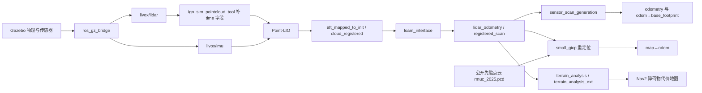
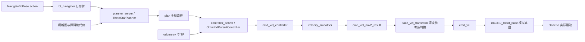

# 上游单机器人导航的数据流

本阶段运行公开 RMUC 2025 场地中的 `red_standard_robot1`。入口是 `scripts/navigation.sh`，内部复用固定版本 `pb2025_sentry_nav` 的传感器、定位、规划及控制节点。它是理解开源系统的基线；校内赛双桩场景和 8 字任务尚未实现。

## 机器人如何知道自己在哪里

三个位姿来源有不同作用：

| 数据 | 含义 | 当前用途 |
|---|---|---|
| `chassis_odometry_gt` | Gazebo 物理引擎给出的真实底盘位姿 | 仅供验收记录实际运动和停止，不接入导航定位 |
| `aft_mapped_to_init` | Point-LIO 从点云与 IMU 估计的雷达里程计 | 经过 `loam_interface` 转换为底盘相关坐标，再生成导航所需里程计 |
| `map→odom` | small_gicp 将当前点云与公开先验点云配准得到的地图对齐 | 使连续里程计坐标与先验地图对齐；这里没有使用 AMCL |

当前 `point_lio.prior_pcd.enable=False`，Point-LIO 自行建立局部里程计地图；先验 PCD 由 **small_gicp** 读取。不要把“加载了先验点云”误解为 Point-LIO 也启用了先验模式。

地图服务器还加载上游 `map/simulation/rmuc_2025.yaml` / `.pgm`。这是给全局规划器使用的二维栅格图，与 small_gicp 的三维点云图是两种资源。

## 目标如何变成运动

`plan` 是全局路径，`local_plan` 是控制器当前使用的局部路径；两者都是实际运行中采样到的消息。`fake_vel_transform` 发布与云台位置相同、朝向稳定的 `gimbal_yaw_fake` 坐标系，并将规划速度转换回 `gimbal_yaw` 参考系。底盘节点读取最终 `cmd_vel`；本阶段没有串口协议链路。

初次验证配置关闭固定自旋（`init_spin_speed=0`），将平移指令上限降至 0.6 m/s，保留上游控制器和障碍物处理算法。到点容差仍是上游配置的 0.15 m，不是校内赛停车标准。

## TF、命名空间与时间

所有以下 topic/action 均位于 `/red_standard_robot1/`。TF 消息通道也在该命名空间内，但消息中的 frame ID 是 `map`、`odom` 等名称，不添加机器人前缀。

| 变换 | 实际发布者 | 作用 |
|---|---|---|
| `map→odom` | `small_gicp_relocalization` | 地图对齐 |
| `odom→base_footprint` | `sensor_scan_generation` | 根据传感器里程计估计底盘位姿 |
| `base_footprint→chassis` 及固定安装关系 | `robot_state_publisher` | 机器人模型 |
| 轮子、云台活动关节变换 | `robot_state_publisher`，输入模拟关节状态 | 关节姿态 |
| `gimbal_yaw→gimbal_yaw_fake` | `fake_vel_transform` | 导航速度的稳定参考系 |

`inspect-navigation.py` 用 C++ MessageInfo 读取实际 DDS publisher GID，并与 ROS 图中的节点对应，逐条检查 TF 是否存在多个发布者；Humble 的 Python executor 不提供所需 GID，不能只凭 topic 上有几个发布者来判断 TF 冲突。

`/clock` 来自 Gazebo。Point-LIO、重定位、地形分析、接口节点、Nav2、RViz 和 joy 节点显式使用仿真时间。上游 RViz / joy 入口没有正确传递时钟参数，本地 launch 使用 `SetParameter` 补齐。仿真底盘和桥接节点的系统时钟参数状态另见验收 JSON；桥接传感器和关节消息保留 Gazebo 时间戳。

Gazebo 初始底盘世界位置是 `(3.4, 9.5)`，导航 map 中的起点接近 `(0, 0)`。因此不能把 `chassis_odometry_gt` 的世界坐标直接作为 map 目标，也不能把地图原点当作 Gazebo 场地原点。

## 如何取消与退出

验收通过 action client 发送目标，等待 `STATUS_SUCCEEDED`；再发送返回目标，确认底盘实际移动后调用 `cancel_goal_async()`。取消必须得到 `STATUS_CANCELED`，最终速度接近零，仿真真值速度低于阈值并连续保持至少两秒墙钟时间。不能只以“取消请求已发出”作为成功。

退出先关闭会向导航服务端请求目标的独立 RViz；其销毁期间保持 TF 与仿真时钟可用。然后通过 Nav2 `manage_nodes` 服务关闭受管理节点，再关闭 Gazebo 发布源及桥接，最后结束导航进程。强制结束、子节点崩溃或生命周期关闭失败均不算验收通过。

## 复核入口

- [运行和验收](validation.md)
- [上游导航启动文件](../nav_ws/src/pb2025_sentry_nav/pb2025_nav_bringup/launch/rm_navigation_simulation_launch.py)
- [上游导航节点及速度 remap](../nav_ws/src/pb2025_sentry_nav/pb2025_nav_bringup/launch/navigation_launch.py)
- [本阶段参数](../config/stage2-nav.yaml)
- 实际图、TF 发布者、时钟参数和消息计数保存在每轮验收的 `graph.json` / `live-interfaces.json` / `tf-authorities.tsv` / `results.json`。

2026-10-12 更新：`sensor_scan_generation` 的车体 TF 与里程计直接跟随传感器 `lidar_odometry`，保留输入时间戳，不再等待注册点云配对；同步回调只用于扫描坐标转换。缺少所需安装变换时不发布单位变换替代值，`loam_interface` 也在安装变换初始化前停止转发扫描。公开上游修复已纳入锁定补丁。另已通过 Gazebo/ROS 原生计数器确认大点云的 DDS 缓冲不足并修复，避免将传输丢帧误归为 GPU 渲染失败；见[本轮对照](validation.md)。
