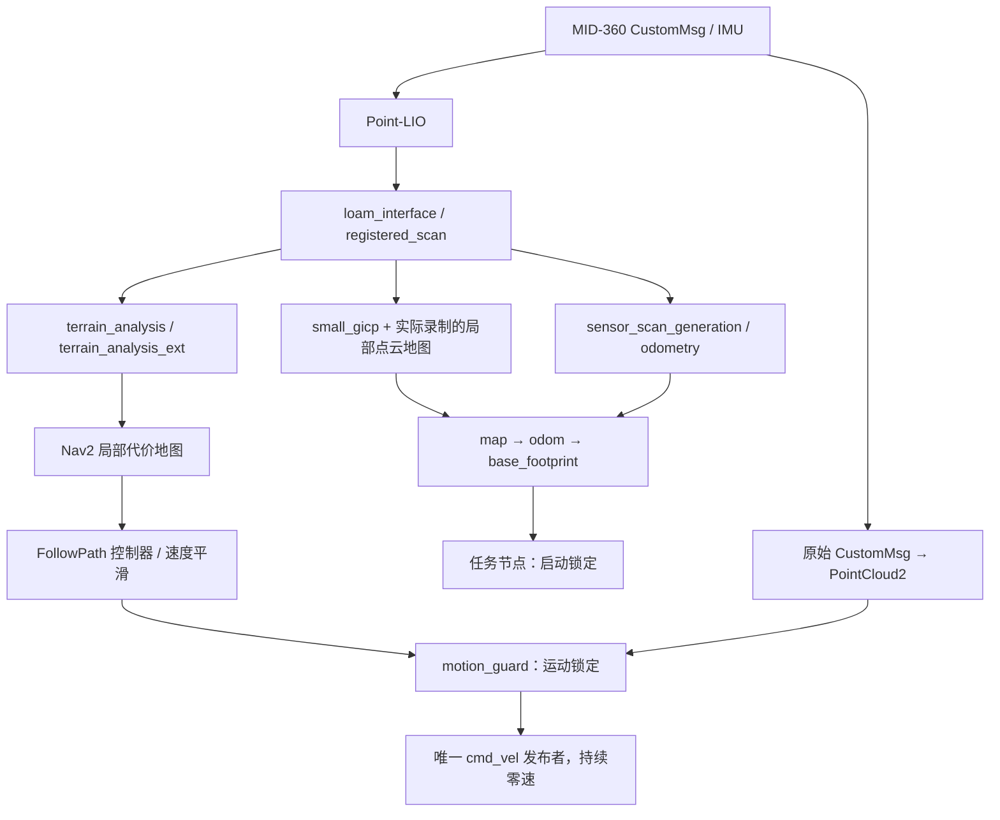

# 真实传感器建图与导航待机

`vehicle-navigation.sh` 接收真实传感器定位数据，运行地图配准、地形分析、Nav2 控制器、任务节点与速度保护。它不启动串口桥；`mission/start` 固定拒绝，`motion_guard` 固定输出零速，适合在车辆静止时检查导航接线。



原始防撞点云保留 Livox 坐标和消息时间戳，不使用地图坐标下的注册点云代替原始扫描。点内时间继续由 Point-LIO 消费，原始防撞适配仅提取 XYZ 和反射强度。驱动的坐标旋转同时作用于点云和 IMU；车体安装变换仅在静态 TF 和车体防撞坐标转换中使用一次。

## 单命令现场流程

NUC 的 qpj 用户可在任意目录执行：

```bash
srm-map
```

命令会检查本机雷达端口，静止初始化后开始录制。采集完成时回到起始位置和朝向、停车，按 **Enter**；随后自动收尾、校验数据、导图、检查栅格、重新启动传感器并验证定位，最后关闭本次进程、释放雷达。**Ctrl-C 取消整个流程**，保留已有数据及失败记录，不将中断记为验收成功。命令不启动串口桥或驱动电机；现场移动由操作者负责。

常用参数：

```bash
# 定时录制；计时从传感器就绪后开始
srm-map --duration 120

# 复用正常保存的 bag，重新导图并进行真实定位重载验证
srm-map --bag /绝对路径/bag

# 指定实车配置和测量过的场地几何
srm-map --vehicle-config /绝对路径/实车配置 --arena-config /绝对路径/场地.json
```

默认输出到项目 `artifacts/mapping/<时间>/`，每次新建目录，不覆盖旧数据。`--output` 可指定项目 `cache/` 或 `artifacts/` 下的新目录；相对路径按执行命令时所在目录解析。主要产物为 `bag/`、`bag-quality.json`、`map/`、`map-quality.json`、`reload-check/` 和 `result.json`。复用 bag 时原始数据保持原位置。

`result.json` 的 `status=complete` 表示采集/处理与定位重载流程完成，**不表示已具备自主行驶条件**。栅格通行性见 `map_quality.navigation_grid_has_clearance`；它将未知区域视为不可通行，并检查车体半径净空。即使有空闲区域，也仍须核对实际比赛路线、控制标定与停机行为。

重复运行会正常关闭本项目记录过的、身份匹配的个人零速待机进程；同时运行第二个 `srm-map` 会被拒绝。其他用户的雷达程序、网卡地址错误、传感器停更、磁盘不足或检查失败都会明确退出并保留日志，不自动修改系统服务或停止别人的程序。开机后旧哨兵程序重新占用雷达时，须先由其用户正常停止，再运行本命令。

新 NUC 一次性安装入口（在项目根目录执行；已有不同目标的链接先检查，不覆盖）：

```bash
mkdir -p "$HOME/.local/bin"
ln -sT "$PWD/scripts/srm-map" "$HOME/.local/bin/srm-map"
ln -sT "$PWD/cache/vehicle-01" "$PWD/cache/vehicle-current"
```

`vehicle-current` 指向当前已准备的实车配置，亦可通过 `--vehicle-config` 指定。确保 `~/.local/bin` 在 PATH 中；不需要 sudo。首次部署仍须完成下面的依赖、构建与实车配置准备。二维导图需要 `c++` 和 `liboctomap-dev`；CLI 在开始采集前检查并编译射线工具，避免扫完才发现依赖缺失。

## 准备与采集

以下命令在项目根目录运行。NUC 使用原生 Humble 环境；不同操作终端保持相同 ROS domain。

```bash
export INTRAMURAL_NATIVE=1
python3 scripts/prepare-sources.py
scripts/build-workspace.sh
python3 scripts/prepare-vehicle.py --output cache/vehicle-01
export INTRAMURAL_VEHICLE_CONFIG="$PWD/cache/vehicle-01"
scripts/vehicle-sensors.sh
```

配置目录不可覆盖；已有配置可直接复用。网络参数可通过 `prepare-vehicle.py --host-ip ... --lidar-ip ...` 指定。启动前会检查主机地址和 SDK UDP 端口；同一物理雷达需独占采集。

另一终端录制真实数据，停止后等待 rosbag 正常收尾。入口使用 SQLite 的 `resilient` 存储设置；采集过程中不要打开或查询正在写入的数据库，频率检查通过 ROS 话题完成：

```bash
export INTRAMURAL_NATIVE=1
scripts/site-mapping.sh artifacts/vehicle-capture
```

## 生成局部实验地图

```bash
scripts/run.sh python3 /work/scripts/prepare-vehicle-navigation.py \
  --vehicle-config "$PWD/cache/vehicle-01" \
  --bag "$PWD/artifacts/vehicle-capture" \
  --output "$PWD/cache/vehicle-navigation-lab"
```

工具从 `camera_init` 中的真实注册点云生成 `prior.pcd`。二维图使用与扫描时间戳匹配的 Point-LIO 位姿及固定 LiDAR/IMU 外参恢复每帧射线起点，拟合近水平地面，再由 OctoMap 更新三维空闲/占据体素并投影为 `map.pgm/map.yaml`。地面按拟合平面距离分类，不假定其地图高度恰好为零；地面回波只清除已观测空间，距地面 0.05—1.4 m 的回波更新障碍占据。投影按体素边界检查高度范围，障碍优先于同列空闲体素，未观测区域保持未知；不对整幅图填白或缩小车体半径来获得通路。`occupancy.json` 保存地面平面、拟合残差、射线数量和算法范围，`manifest.json` 保存来源、点数和文件校验值。缺少同步位姿或地面观测不足时拒绝导图；斜坡、台阶和落差需要另行验证，不能仅依赖这个近平面地面模型。当前导图保留初始雷达原点周围 12 m 内的点，栅格分辨率为 0.05 m；比赛区域超出此范围时必须先调整范围并重新验证，不能把裁掉的区域当成已建图。

这是局部实验地图，不含测量过的比赛桩位、停车位与路线坐标；`arena.json` 中的任务几何仍为待替换的初值。手推数据没有独立距离、角度基准，不能据此宣称定位精度或外参已标定。

## 导航待机与检查

保持传感器入口运行，在另一个终端启动：

```bash
export INTRAMURAL_NATIVE=1
export INTRAMURAL_NAVIGATION_CONFIG="$PWD/cache/vehicle-navigation-lab"
scripts/vehicle-navigation.sh
```

第三个终端执行真实接口验收。它激活 map_server、controller_server 和 velocity_smoother，检查点云、里程计、地形、地图、TF 发布者、实际时钟、任务拒绝和持续零速。提供 `--map-config` 后还比较实时注册扫描与新地图的最近邻距离，拒绝明显未对齐的结果：

```bash
export INTRAMURAL_NATIVE=1
scripts/run.sh python3 /work/scripts/validation/verify-vehicle-standby.py \
  --output "$PWD/artifacts/vehicle-standby" \
  --map-config "$INTRAMURAL_NAVIGATION_CONFIG"
```

待机时 `mission/status.ready=false` 是预期行为：任务和运动许可被锁定，控制器可以处于 active。入口不提供绕过锁定的运动参数。

结束前先关闭受管理节点，再依次在导航、传感器终端按 Ctrl-C：

```bash
scripts/run.sh ros2 service call \
  /intramural_robot/lifecycle_manager_vehicle/manage_nodes \
  nav2_msgs/srv/ManageLifecycleNodes '{command: 4}'
```

## 转入运动调试前

现场确认固件采用比赛协议后，可独占串口执行只发零速的诊断，配置目录和运动门禁不需要改动：

```bash
scripts/run.sh python3 /work/scripts/validation/verify-serial-zero.py \
  --device /dev/serial/by-id/<实际串口设备> \
  --output "$PWD/artifacts/serial-zero-check"
```

该工具只允许全零指令，约 100 Hz 持续 8 秒，保存原始回包和 CRC 解析结果。收到状态帧能确认反馈链路，协议没有速度确认应答，不能以此证明速度帧已被执行或断链停机已通过。裁判状态字段全零时还需核实裁判数据来源。

仍需完成比赛场地测绘和地图对齐、独立位置与角度测量、最大车体包络核对，以及 MCU 当前固件的 19 字节协议、断链停车、控制模式和速度映射验收。`base-vehicle.json` 的三项实车验证标志保持 false，实际串口桥继续拒绝未验证配置。仿真、局部地图配准和零速待机不能替代这些实测。

## 现场建图流程的复用验证

调试场地地图只用来验证工具链；比赛场地变化后，应重新采集并导出到新目录，不能沿用旧图或旧桩位。

一次完整检查包括：

1. 启动前确认雷达端口空闲，同机没有另一套雷达或底盘控制程序；仅 ROS domain 不同不能隔离物理设备。NUC 重启后需要再次检查旧程序自启。
2. 车辆静止完成 Point-LIO 初始化，确认有连续注册点云后开始记录。电机禁用下缓慢推行，覆盖拟行驶区域，避免长时间遮挡雷达；尽量回到起始标记及朝向。
3. 在录制终端 Ctrl-C 正常结束，等待 rosbag 完成写盘。用下列命令确认 bag 时长、各话题消息数和存储文件可读；若录制被断电打断，应先保留原件并修复副本，不直接作为验收数据。
4. 运行地图生成命令，检查点云与栅格中的墙面、障碍和可见通道，保留原始 bag 供复核。空洞或明显重影需要补采或排查，文件生成成功不等于地图可用。
5. 结束传感器进程，将车置于相同起始标记和朝向，重新静止初始化，然后用刚生成的地图启动导航待机并执行检查命令。确认重启后配准、TF 与数据流恢复。不同初始位置的重定位能力需另测，不由这一步推定。

```bash
scripts/run.sh ros2 bag info /work/artifacts/vehicle-capture
scripts/run.sh python3 /work/scripts/validation/verify-mapping-bag.py \
  --bag /work/artifacts/vehicle-capture \
  --output /work/artifacts/vehicle-capture-quality.json
```

校验工具完整读取原始雷达、IMU、注册点云和里程计，检查 SQLite 完整性、必要话题、频率、最长间断、时间戳倒退和非有限数。校验通过后再导图；失败报告保留用于定位采集问题，不能跳过缺失的传感器数据。

手推回到标记仅用于流程及明显漂移检查；没有独立量具时不据此报告定位精度。保留每轮的启动日志、bag、地图和待机检查输出，地图与原始数据仅留现场个人目录。

## 现场八字验收的推进顺序

1. 架空核对底盘模式、正负轴向、回零停止和断链停止，再用独立距离测量确定速度倍率。串口收到状态帧不等于速度指令已执行。
2. 到场后从固定停车位置、固定朝向启动传感器，先静止初始化，再录制覆盖两根桩、交叉区和返回通道的数据。采集期间保持底盘电机禁用，人工安全推行；结束录制后等待文件写完。
3. 生成地图并核对墙、桩和空闲通道。当前工具按每帧射线重建空闲空间并按地面相对高度投影；未观测区域保持未知，需补采缺失区域。
4. 在地图坐标下填写实际场地几何，核对路线与实物，再进行导航待机检查。
5. 底盘映射、停机和场地核对完成后接通受保护的串口运动链，先低速直线和停车，再完整八字，最后验证挡路停车与移除恢复。

第 4 步的场地配置从 `config/arena.json` 复制到本地 `cache/field-arena.json`，修改停车位、上下桩位、场地边界、桩半径、绕行半径及实际车体包络。当前路线生成器要求两桩在地图中具有相同 x，桩间距等于绕行半径的两倍；必须核对坐标朝向和实际几何，不能直接沿用仿真数值。

```bash
scripts/run.sh python3 /work/scripts/prepare-vehicle-navigation.py \
  --vehicle-config "$PWD/cache/vehicle-01" \
  --bag "$PWD/artifacts/vehicle-capture" \
  --arena-config "$PWD/cache/field-arena.json" \
  --output "$PWD/cache/vehicle-navigation-field"
export INTRAMURAL_NAVIGATION_CONFIG="$PWD/cache/vehicle-navigation-field"
scripts/vehicle-navigation.sh
```

新配置设置 `allow_bypass=false`：障碍持续存在时保持停车，移除且满足恢复条件后继续当前路线分段。仿真默认的持续障碍绕行策略不受影响。

上述入口仍是待机入口，不能启动实际八字。最终运动入口须在底盘实测完成后接入；不通过手工修改验证标志绕过验收。建图、待机、实车运动和完整任务验收分别记录结果。
